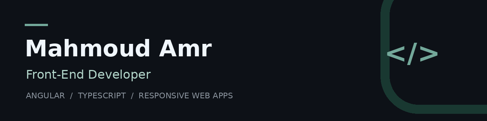
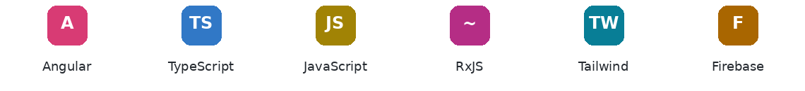
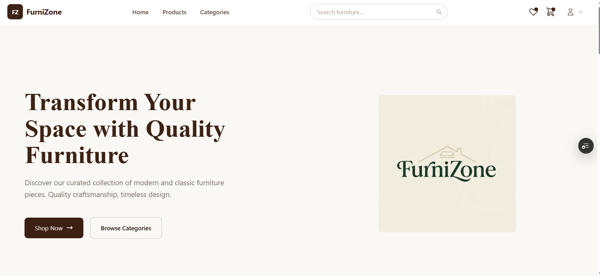
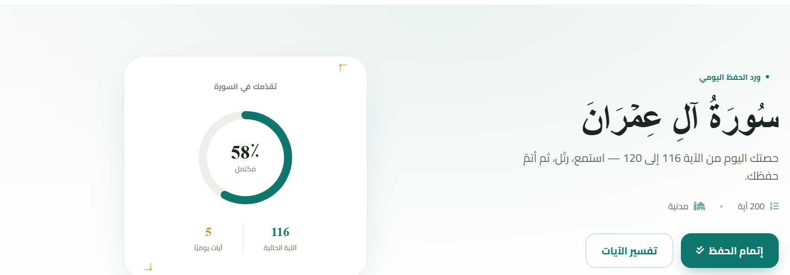

# Hi, I'm Mahmoud

I'm a Front-End Developer focused on building responsive web applications with Angular and TypeScript. I work with reusable components, RxJS, REST API integration and Firebase.

## Technologies

- **Frontend:** Angular, TypeScript, JavaScript, HTML, CSS, SCSS, RxJS, Angular Material
- **UI:** Tailwind CSS, Bootstrap, responsive design
- **Integration:** REST APIs, Firebase Authentication, Firestore
- **Tools:** Git, GitHub, Postman, npm
- **Also worked with:** Node.js, NestJS, PostgreSQL, MongoDB, SQL Server

## Selected projects

### FixIt | Home services marketplace

A team graduation project connecting customers with technicians for home services.

**My contribution:** Angular frontend development, reusable components, responsive pages and REST API integration for authentication, bookings and technician management.

**Frontend:** Angular, Tailwind CSS

[View repository](https://github.com/Ma7moud-02003/FixIt)

### FurniZone | Furniture e-commerce

A collaborative furniture e-commerce project with product browsing, a shopping cart, order management, reviews and an admin dashboard.

**My contribution:** Responsive Angular pages, reusable components and REST API integration for products, orders, reviews and authentication.

**Frontend:** Angular, Tailwind CSS

[View repository](https://github.com/Ma7moud-02003/FurniZone)

### Hifzah | Quran memorization

An Angular app for personalized memorization plans and daily progress tracking, with Firebase Authentication and Firestore.

**Features:** Surah and reciter selection, daily verse targets, memorization plan management and progress tracking.

**Stack:** Angular, Tailwind CSS, Firebase, Firestore

[View repository](https://github.com/Ma7moud-02003/Hefzehh)

## Background

- BSc in Mathematics & Computer Science, 2026
- Front-End Development training through the Digital Egypt Pioneers Initiative (DEPI), 2026
